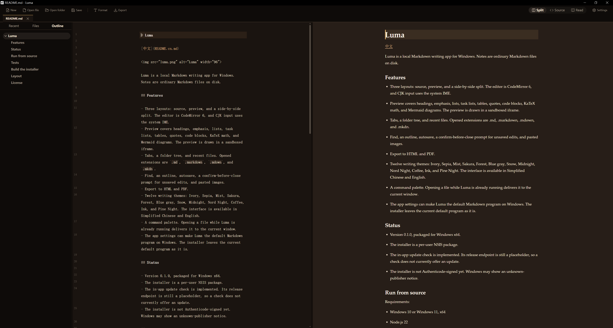
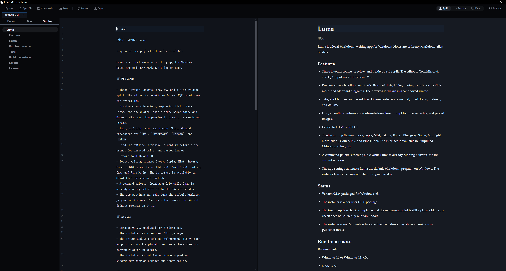
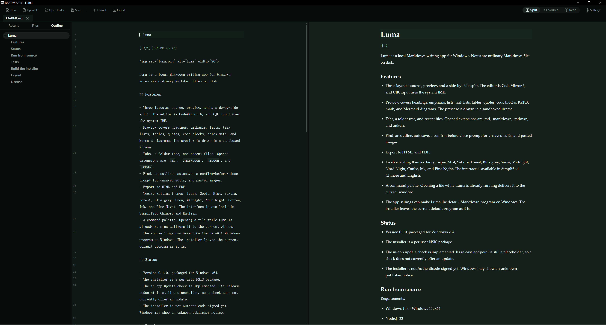

# Luma

[中文](README.cn.md)


Luma is a local Markdown writing app for Windows. Notes are ordinary Markdown files on disk.

## Features

- Three layouts: source, preview, and a side-by-side split. The editor is CodeMirror 6, and CJK input uses the system IME.
- Preview covers headings, emphasis, lists, task lists, tables, quotes, code blocks, images, KaTeX math, and Mermaid diagrams. The preview is drawn in a sandboxed iframe.
- Tabs, a folder tree, and recent files. Opened extensions are `.md`, `.markdown`, `.mdown`, and `.mkdn`.
- Find, an outline, autosave, a confirm-before-close prompt for unsaved edits, and pasted images.
- Export to HTML and PDF.
- Twelve writing themes: Ivory, Sepia, Mist, Sakura, Forest, Blue gray, Snow, Midnight, Nord Night, Coffee, Ink, and Pine Night. The interface is available in Simplified Chinese and English.
- A command palette. Opening a file while Luma is already running delivers it to the current window.
- The app settings can make Luma the default Markdown program on Windows. The installer leaves the current default program as it is.

## Screenshots







## Status

- Version 0.1.0, packaged for Windows x64.
- The installer is a per-user NSIS package.
- The in-app update check is implemented. Its release endpoint is still a placeholder, so a check does not currently offer an update.
- The installer is not Authenticode-signed yet. Windows may show an unknown-publisher notice.

## Run from source

Requirements:

- Windows 10 or Windows 11, x64
- Node.js 22
- Rust 1.94.0 (`rust-toolchain.toml` selects this version)
- Visual Studio Build Tools with the MSVC toolchain
- The WebView2 runtime (already present on a typical Windows 11 install)

From the repository root:

```text
npm install
npm --prefix frontend install
npm run dev
```

`npm run dev` starts the development binary. That binary has a console window and loads the UI from `http://localhost:1420`. Point Explorer's Open with entry at the installed `%LOCALAPPDATA%\Luma\luma.exe`.

## Tests

```text
npm run test:js
npm run test:rust
```

## Build the installer

`npm run build` writes `target/release/bundle/nsis/Luma_0.1.0_x64-setup.exe`. The version in that file name matches `version` in `src-tauri/tauri.conf.json`.

The package includes an updater signature, so the build needs your own minisign key. Run this in PowerShell. It prompts for a password:

```powershell
npx tauri signer generate -w "$env:USERPROFILE\.tauri\luma.key"
```

Leave off `--force` when a key is already there. That flag overwrites the existing key.

Set the environment variables in the same PowerShell window, then build. `TAURI_SIGNING_PRIVATE_KEY` is the path to the key file:

```powershell
$env:TAURI_SIGNING_PRIVATE_KEY = "$env:USERPROFILE\.tauri\luma.key"
$env:TAURI_SIGNING_PRIVATE_KEY_PASSWORD = "<the password you chose>"
npm run build
```

Keep the key file and the password on your machine. Do not commit them.

The installer places Luma in the current user's `%LOCALAPPDATA%\Luma`. Uninstall keeps the user's Markdown files and the settings under `%APPDATA%\dev.luma.desktop`.

## Layout

The stack is Tauri 2.12, Rust, React 19, TypeScript, and CodeMirror 6.

- `frontend/`: the interface, React and Vite.
- `src-tauri/`: the Tauri desktop shell. Windows installer hooks live in `src-tauri/windows/`.
- `crates/rustmark-core/`: internal library for documents, paths, and settings. The product name is Luma.
- `crates/markdown-engine/`: Markdown parsing on pulldown-cmark.
- `crates/markdown-render/`: preview data and export.

## License

Licensed under the [Apache License 2.0](LICENSE).
